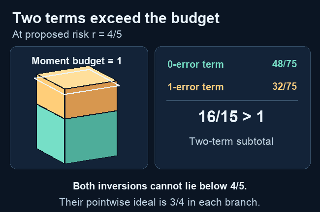

# A strict gap for a common PAC-Bayes comparator

With two iid fair Bernoulli labels, every single prechosen proper closed convex comparator has a strict expected gap above the pointwise optimistic PAC-Bayes-kl inversion. The gap is at least **(7 − √34)/80**, and a fixed Catoni comparator gives at most **9/176** for the same setup. This answers the universal attainability part of Foong et al.’s Open Problem 1. [Original question, p. 10](https://proceedings.neurips.cc/paper_files/paper/2021/file/214cfbe603b7f9f9bc005d5f53f7a1d3-Paper.pdf#page=10)

[Paper PDF](paper/manuscript.pdf) · [LaTeX source](paper/manuscript.tex) · [Proof outline](proof/PROBLEM_AND_PROOF.md)

## Two branches share one moment budget

If both relevant sample branches beat a proposed upper inversion of $4/5$, two normalized moment terms alone exceed $16/15$, above their budget of $1$. Taking the exact root of the two-term subtotal sharpens the resulting expectation gap.

[Download the offline explorer ZIP](https://raw.githubusercontent.com/DannyExperiments/pac-bayes-comparator-attainability/v1.0.0/visualization/pac-bayes-comparator-attainability-explorer.zip) · [Worked example](visualization/README.md)

## Scope and checks

The result is for the expectation of samplewise inversions using one comparator in the generic theorem. The paper also gives a distribution-free upper estimate from the ordinary KL comparator. It leaves the exact optimal gap and the possible validity of the optimistic high-probability expression by other proof methods as separate questions. [Claim scope](CLAIM_SCOPE_AND_LIMITATIONS.md) · [Literature audit](audits/public_safe_reports/LITERATURE_AUDIT.md)

Exact Python replay and a partial Lean certificate cover the finite law and rational arithmetic. Internally reviewed, not peer reviewed. [Reproducibility](REPRODUCIBILITY.md) · [Technical disclosure](AI_DISCLOSURE.md)

DannyExperiments is the preferred citation identity. [Release v1.0.0](https://github.com/DannyExperiments/pac-bayes-comparator-attainability/releases/tag/v1.0.0) · [Version DOI](https://doi.org/10.5281/zenodo.24572901) · [Citation metadata](CITATION.cff)
